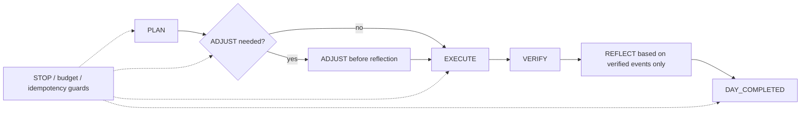

# Architecture (Public Reference)

The preview shows the safety semantics with fictional data. The Android implementation adds SQLite persistence, WorkManager and ContextBuilder; those are not exported yet.